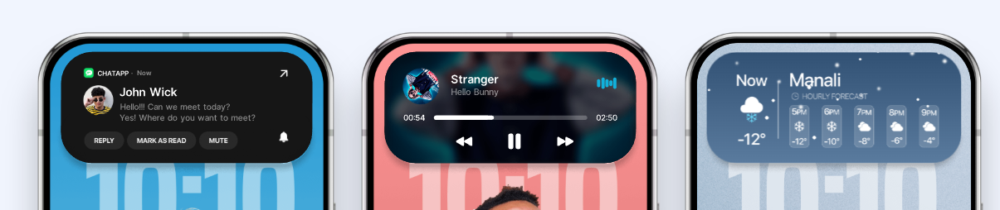
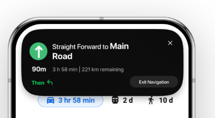
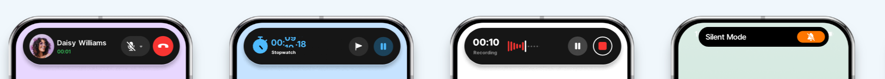
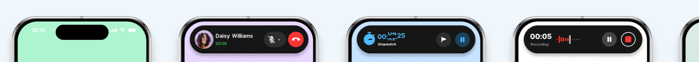
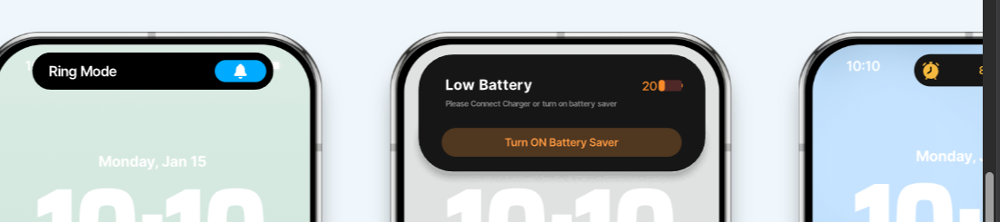
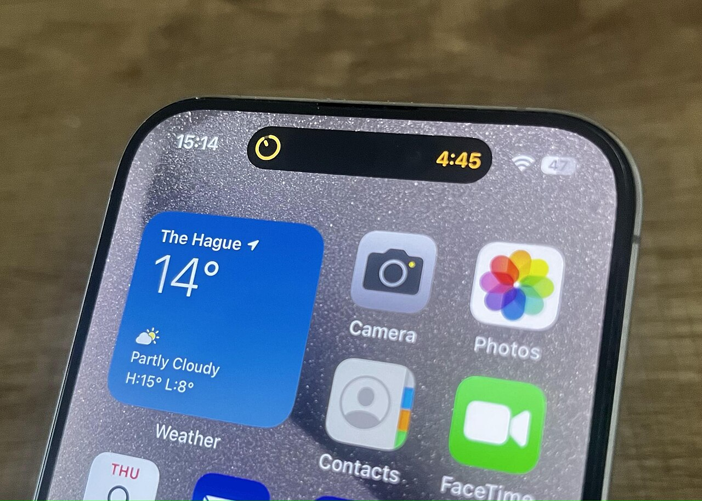
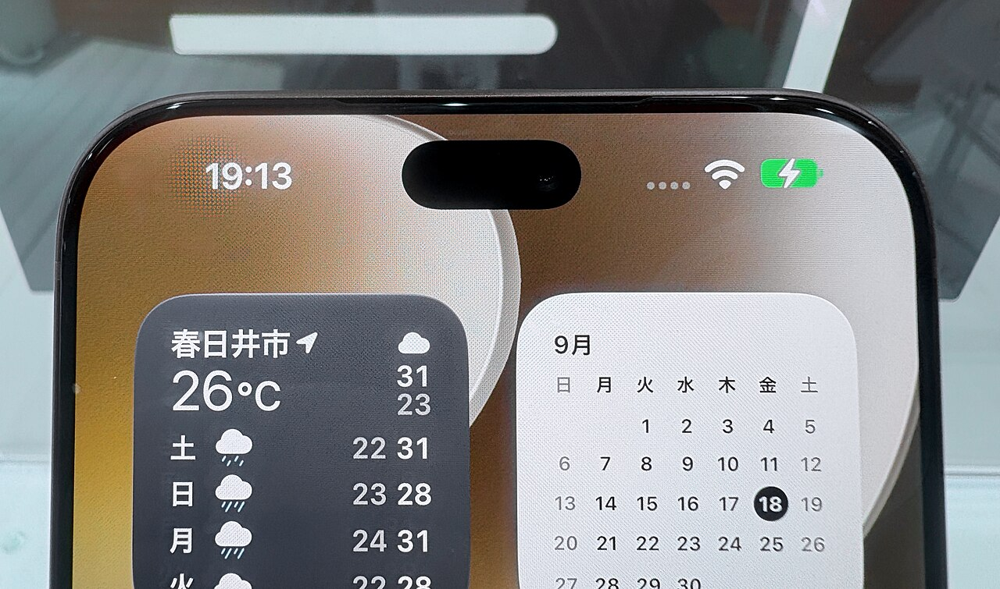

# Notchy notch design reference

The target look for the phone notch (and later the PC notch): Apple's Dynamic Island. This
document collects the reference images, Apple's published rules and measurements, and what
Notchy has to change to meet them.

## 1. Reference images

All images live in [`reference/`](reference/).

### Owner's references (the look we want)

| | |
|---|---|
|  | Notification card with avatar, app name, two-line message and Reply / Mark as read / Mute chips. Music card with artwork, title, scrubber with times, and transport controls. Weather card with hourly forecast columns. |
|  | Navigation: big green turn arrow, "Straight forward to **Main Road**", distance, ETA, and an "Exit Navigation" chip. |
|  | Compact-wide pills: call (avatar, name, green timer, mute and red hang-up circles), stopwatch (blue icon and digits, flag and pause circles), recording (red waveform, pause and stop), Silent Mode (label and orange bell pill). |
|  | The resting island (a small black capsule), then the same activities growing out of it. |
|  | Ring Mode (blue bell pill), Low Battery card (title, subtitle, orange level, wide orange button), Alarm (compact, yellow icon). |

### Real hardware (Wikimedia Commons)

| | |
|---|---|
|  | iPhone 15 Pro with a timer: a pure-black capsule, leading icon and trailing digits hug the camera, tinted yellow. Photo: Wikimedia Commons, *IPhone Dynamic Island.jpg*. |
|  | Close-up of the resting island. Wikimedia Commons, *Dynamic Island of iPhone 18 Pro Max.jpg*. |
| [Vector outline](reference/di-vector-14pro.svg) | iPhone 14 Pro outline with the island, for proportions. Wikimedia Commons, *IPhone 14 Pro DI Vector.svg*. |

## 2. Apple's rules (Human Interface Guidelines, Live Activities)

Source: [developer.apple.com/design/human-interface-guidelines/live-activities](https://developer.apple.com/design/human-interface-guidelines/live-activities).

**Three presentations**
- **Compact**: one activity. A *leading* view left of the camera and a *trailing* view right of it,
  reading as one piece of information.
- **Minimal**: several activities. One attached to the island, others as small detached circles or ovals.
- **Expanded**: touch and hold. A larger card that grows out of the compact one.

**Layout**
- Content sits **snug against the camera**: no padding between content and the sensor.
  Keep compact views as narrow as possible.
- Leading and trailing views are **similar widths**. Use short units for balance.
- Margins are **even and concentric**. An inner rounded shape uses the outer radius minus the
  margin, so nothing "pokes into" the curve.
- Never draw content to the very edge. Separate groups with an inset container or a thick line.
- Limited width: compact and minimal content fits a **28 pt circle**.
- Expanded height grows with content.

**Colour and type**
- The background is always **opaque black**.
- Text and glyphs use **bold colours**: one key colour per activity (green call, orange timer,
  red recording, yellow alarm, blue ring mode).
- Text is **large and medium weight or heavier**. Small text is used sparingly.
- In dark mode a thin **key line** in the activity's colour outlines the island.

**Motion**
- Every transition **morphs one shape**; nothing pops in. Expand is a slightly bouncy spring,
  collapse is a critically damped spring.
- Animations last **at most 2 s**. Move existing elements rather than removing and re-adding them,
  avoid overlapping elements, and use numeric transitions for changing numbers.

**Measurements (points)**

| Screen | Compact leading/trailing | Minimal | Expanded | Limited width |
|---|---|---|---|---|
| 393 × 852 | 52.33 × 36.67 | 36.67–45 × 36.67 | 371 × 84–160 | 28 × 28 |
| 430 × 932 | 62.33 × 36.67 | 36.67–45 × 36.67 | 408 × 84–160 | 28 × 28 |

- Resting island is about **126 × 37 pt**. The expanded card is about **screen width − 22 pt**
  wide, with corners near **44 pt** (camera-concentric; not published by Apple, measured by the community).
- Lock-screen banner margin: **14 pt**.

Community sources on the motion: [uxdesign.cc, animations dissected](https://uxdesign.cc/apples-dynamic-island-animations-dissected-into-4-principles-b3bfdf546d9a),
[spring notes for Apple Music and the island](https://claudiusma.notion.site/Staged-Spring-Static-friction-12d422d326808006b952f69ee09b7cf2),
[React clone write-up](https://oliverpan.vercel.app/blog/building-ios-dynamic-island),
[UX Planet guide](https://uxplanet.org/unlimited-guide-to-dynamic-island-48700ecc094f),
[Infinum guide](https://infinum.com/?p=28092).

## 3. Notchy design tokens (phone)

Converted to Android dp (1 pt ≈ 1 dp).

| Token | Value |
|---|---|
| Island colour | `#000000`, opaque |
| Resting island | camera diameter × 3.6 wide, camera + 8 dp tall, fully round |
| Compact (one activity) | resting height; leading and trailing slots 52 dp each, hugging the camera |
| Expanded card | screen width − 2 × 11 dp; height from content (84–180 dp); corner radius 40 dp |
| Inner margin | 14 dp; inner corners = 40 − 14 = 26 dp (concentric) |
| Type | Title 15 sp semibold white; body 13 sp regular, 60 % white; numbers 15–17 sp semibold with tabular figures; small caps label 11 sp, 55 % white |
| Buttons | Circles 36 dp, fill white 12 %, icon white; the primary action is filled with the key colour (red hang-up, orange battery saver) |
| Chips | 28 dp tall, fully round, fill white 12 %, 12 sp semibold |
| Key colours | call `#30D158`, timer `#FF9F0A`, recording `#FF453A`, alarm `#FFD60A`, ring `#0A84FF`, silent `#FF9F0A`, charge `#30D158`, low battery `#FF9F0A` |
| Motion | Expand: spring stiffness 380, damping ratio 0.72. Collapse: stiffness 500, damping ratio 1.0. Content fades in at 40 % of the morph and out in the first 15 %. |

## 4. What is wrong today (phone)

- The island **never expands into a card**. Every event becomes two words squeezed into
  a pill ("Call: Mom", "♪ Song"). No artwork, no buttons, no progress bar.
- **Text is tiny** (9.5–12 sp) and uses fake-bold instead of real weights.
- **Emoji are used as icons** (⏭ 🤫 ☀ ⚡), which look cheap and differ per phone.
- **Eyes are lime-green blobs with a glow** on every pill, even mid-call. The robot competes
  with the content instead of stepping aside.
- **Clutter**: badge dots, streak dot, speed text, privacy dot and scarf line all fight for the
  same few pixels.
- Motion is a linear width tween (420 ms decelerate). There is no spring and no height change.
- The overlay window is only as large as the widest pill, so a card physically cannot be drawn.

## 5. Plan

1. **New `IslandView`** for the phone: one black shape that morphs (spring) between *rest*,
   *compact* (leading and trailing slots) and *expanded* (card). The overlay window resizes with the
   shape so it never blocks touches outside it.
2. **Activities**, each with compact and expanded layouts following the references: incoming or ongoing
   call, music, timer and stopwatch, notification (with Reply / Mark read / Mute), ring and silent
   switch, charging and low battery, live progress (ride, delivery, download), navigation, and the
   robot's own messages.
3. **Robot redesign**: in rest only, two soft white capsule eyes (no lime, no glow) with real
   expressions (happy arcs, sleepy lines, focused squint, surprised circles). When an activity
   is showing, the robot hides.
4. Real vector icons (no emoji) and real font weights (`sans-serif-medium`).
5. Then the PC notch and the PC and phone app screens follow the same tokens.

## 6. Dribbble shots to study

The most-liked phone shots in the [Dynamic Island collection](https://dribbble.com/javitoluz/collections/7737290-Dynamic-Island).
They are linked rather than copied because the images belong to their designers. Dribbble
blocks automated reading, so open these by hand.

| Shot | Designer | Idea for Notchy |
|---|---|---|
| [Wareg: food delivery](https://dribbble.com/shots/19623714-Wareg-Food-Delivery-Dynamic-Island) | BTA Studio | Delivery progress in the live card |
| [Android Dynamic Island](https://dribbble.com/shots/25604942-Android-Dynamic-Island) | Geex Arts | Island around an Android punch-hole: our exact case |
| [Ember: island and watch](https://dribbble.com/shots/23254244-Ember-Dynamic-Island-Apple-Watch-App-Concept) | Vektora | Companion device: PC link status |
| [Finance widgets](https://dribbble.com/shots/22787403-Finance-Widgets-for-Dynamic-Island) | HYPEOPLE | Spending card (Expenses) |
| [Image search](https://dribbble.com/shots/26092024-iOS-Dynamic-Island-Image-Search) | Malan Alankara | Screenshot → send to PC card |
| [Dog video alert](https://dribbble.com/shots/19554744-Apple-Dynamic-Island-Concept-Dog-video-alert) | Pontus Wellgraf | Rich media inside a card |
| [Worldcoin concept](https://dribbble.com/shots/19399341-Worldcoin-Dynamic-Island-concept) | thirdweb-studio | Verify / unlock flow: unlock the PC |
| [Delivery live activity](https://dribbble.com/shots/20764275-Delivery-live-activity-in-the-Dynamic-Island-on-iPhone) | Roman Vorokhib | Compact delivery ETA |
| [Voice notification](https://dribbble.com/shots/23223907-Voice-Notification-Dynamic-Island-Style-Animation) | Mohamad Shahrestani | Voice note with waveform |
| [App notifications](https://dribbble.com/shots/22101499-Dynamic-Island-App-Notifications) | Atheeb | Notification card |
| [Running app](https://dribbble.com/shots/20840296-Dynamic-island-running-app-animation) | Alexandru Hasmatuchi | Activity with live stats |
| [Gym](https://dribbble.com/shots/25773376-Dynamic-island-Gym) | adiatma bani | Workout timer |
